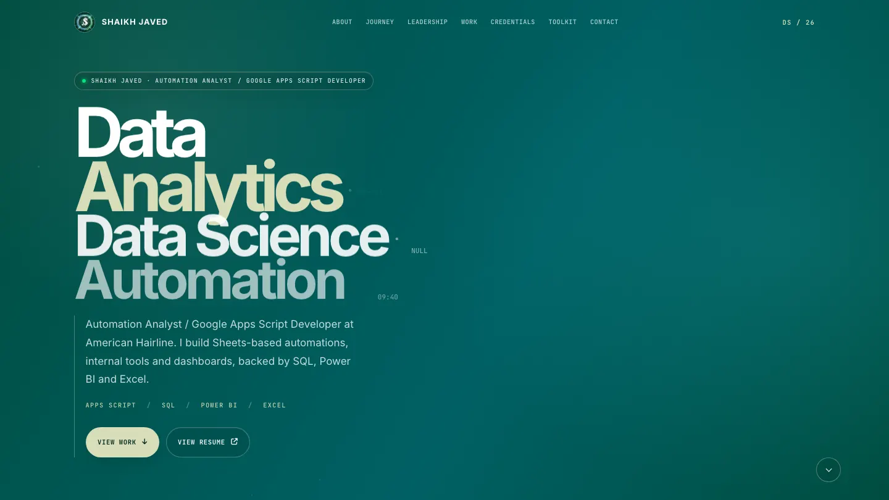
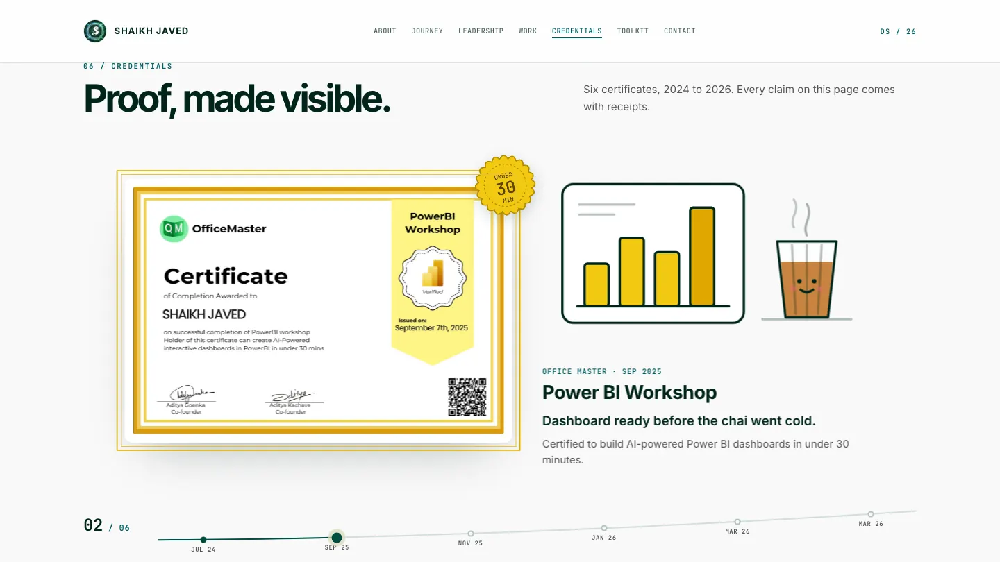
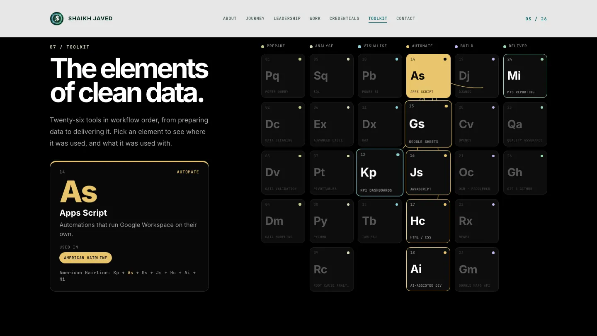

# Shaikh Javed — Portfolio

**Automation Analyst and Google Apps Script Developer in Mumbai.**
Google Sheets automations, internal tools and dashboards; SQL, Power BI, Excel.

### [View the live site →](https://shk-javed.github.io/shaikhjaved.portfolio/)

<a href="https://shk-javed.github.io/shaikhjaved.portfolio/">
  
</a>

This is a single-page portfolio that I built by hand. A scroll-driven canvas film opens the page. After that it covers my work in automation, analytics and data. It uses plain HTML, CSS and JavaScript in one file, with no framework and no build step.

## What's inside

- **Hero**: a cinematic, scroll-driven canvas film.
- **About**: who I am and what I work on.
- **Experience**: American Hairline (Automation Analyst / Google Apps Script Developer) and MAK { Byte } (Data Analyst).
- **Education**: B.Sc. Data Science.
- **Leadership**: I led a hackathon team that built Maayura, showcased a project on stage at GDG DevFest Mumbai, served as a Google Student Ambassador and contributed to open source.
- **[Work](https://shk-javed.github.io/shaikhjaved.portfolio/#projects)**: five projects, each with its own animated poster. They are the Aadhaar Masking Tool, a Customer Service MIS, a Domestic Airline KPI Dashboard, a Hospital ER Dashboard and a Spotify 2023 Dashboard.
- **Certificates**: a pinned horizontal reel of six certificates. Each one has an illustrated scene that is funny but true.
- **[Toolkit](https://shk-javed.github.io/shaikhjaved.portfolio/#skills)**: a periodic table of 26 tools. Lines between the tiles show which tools were used together.
- **Contact**: email and a live Mumbai clock.

<p>
  
  
</p>

## How it's built

- **Vanilla only.** Everything is semantic HTML, CSS and plain JavaScript in `index.html`. The hero film is drawn with Canvas 2D, and the posters and certificate scenes are inline SVG.
- **Accessible.** It uses landmark sections, a logical heading order and descriptive alt text. Everything interactive works with the keyboard and shows a visible focus state.
- **Reduced motion.** When `prefers-reduced-motion` is set, every animation switches to a calm, static version and no content is lost.
- **Performance.** Animation runs on `requestAnimationFrame` with a capped device-pixel ratio and pauses when it is off-screen. Images are compressed. The only external requests are Google Fonts and Font Awesome.
- **Hosting.** The site is served by GitHub Pages straight from this repository.

## Run locally

```bash
git clone https://github.com/shk-javed/shaikhjaved.portfolio.git
cd shaikhjaved.portfolio
python3 -m http.server 8000
```

Then open <http://localhost:8000>. There is nothing to install or build.

## Contact

- Email: [shkjaved41@gmail.com](mailto:shkjaved41@gmail.com)
- LinkedIn: [linkedin.com/in/shk-javed](https://www.linkedin.com/in/shk-javed/)
- GitHub: [github.com/shk-javed](https://github.com/shk-javed)
